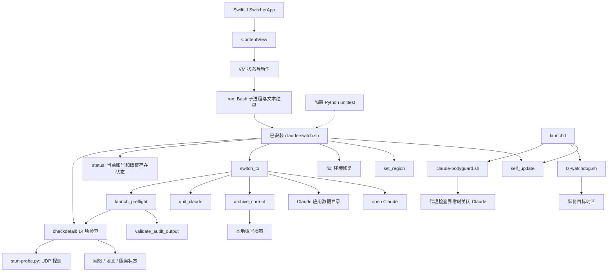

# 现有代码图谱与 UI 概念

日期：2026-10-22。阶段：现状梳理完成，视觉方向已确认。[Rust 重写方案](../plans/rust-rewrite-plan.md) 已形成评审稿。

## 项目定位

- 会话：Claude切换器独立项目。
- 项目：Claude切换器。
- 工作目录与 Git 根目录：`/Users/gua/CodexWorkspaces/claude-switcher`。
- CodeGraph：`.codegraph/`，状态 complete，139 个节点、225 条关系、6 个索引文件；当前待同步文件为 0。
- 自动索引覆盖 Python、Swift。下图的 Shell 关系来自脚本入口和函数源码补充阅读；自动索引统计仅代表其覆盖范围。

## 现有调用关系

## 关键文件

| 文件 | 职责 |
| --- | --- |
| `app/main.swift` | SwiftUI 界面、检查状态、子进程、账号动作 |
| `core/claude-switch.sh` | 检查、启动门禁、账号档案交换、修复、地区配置、更新、代理诊断 |
| `core/stun-probe.py` | 并发 STUN 探测 |
| `daemons/` | 系统守护脚本和 launchd 模板 |
| `installer/安装.command` | 安装、配置、编译和服务注册 |
| `tests/test_switch_safety.py` | 隔离启动、检查结果完整性、警告处理等回归 |
| `tests/test_proxy_diagnose.py` | 独立代理诊断回归 |
| `windows/`、`linux/` | 平台实现；后续方案阶段明确移植范围 |

已核对 UI 状态：checking、ready、failed、switching、done、fixing。当前 GUI 通过已安装脚本执行动作。源码副本与已安装运行文件需要在后续方案中明确管理。

## 视觉方向

概念图：`ui-concept-v1.png`。暖白、墨绿、细分隔线、横向工作台。

- 左侧导航负责页面切换。
- 中部聚焦当前账号和“检查并启动 Claude”。
- 右侧呈现检查摘要和待处理项。
- 底部用网络、地区、后台服务三个入口展开详情。
- 账号选择与启动设计为两个明确操作；属于拟议交互。

图片中的状态、账号档案、导航页面均为设计示例。后续设计稿需补充首次使用、检查中、检查失败、修复中、切换中、完成等状态。

图中文字校对记录：连接说明中的“安全访问·正常连接”应随实际检查结果呈现；ASN 提示应改为“网络运营商信息暂未获取”；代理加密描述应依据实际协议呈现。此轮视觉方向可供用户评审，交互和文案在详细方案阶段定稿。

设计产物包括本图谱、概念图和视觉评审记录。用户已确认视觉方向；下一步评审 Rust 重写方案。
