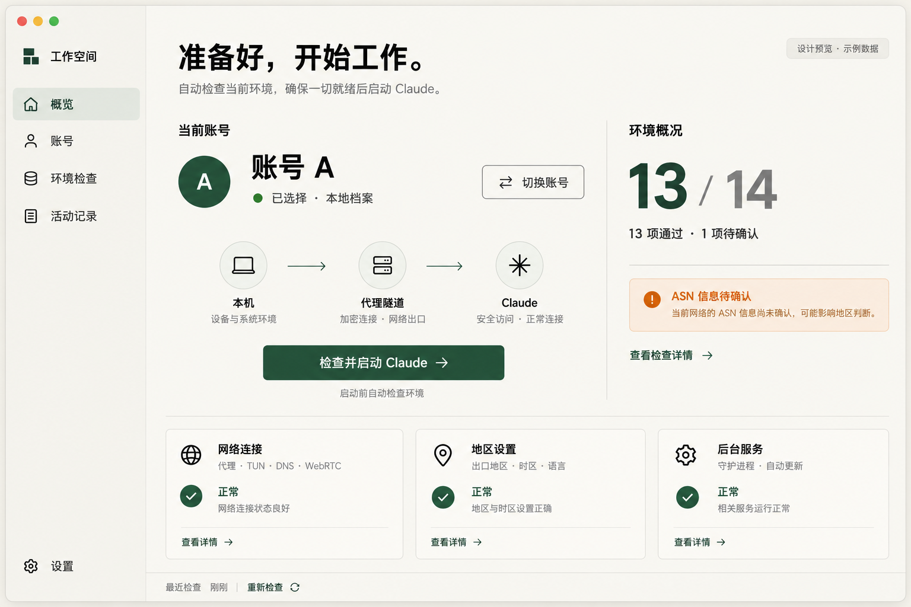

# Claude 切换器 Rust 重写方案

版本：v2.2 评审修订稿。修订日期：2026-10-22，Asia/Taipei。

**推荐采用 Tauri 2 + Svelte 5 / TypeScript 界面 + Rust 核心。沿用已确认的暖白、墨绿、横向工作台设计。先完成 macOS 版，再按独立里程碑评估 Windows 与 Linux 移植。**

**采用一套核心代码、两套发行策略。自用版手动更新；对外发布版默认自动更新。对外发布版预留广告位与服务链接。**

本轮补齐广告管理和持续发布流程。Rust 实施从方案评审完成后开始。本机旧版的定时更新继续保持停用。

本版沿用授权前写入风险、受控 helper 安装、空闲更新条件和三广告位布局的修订。新增自用版广告管理页、签名发布、15 分钟刷新、排期、撤回与历史恢复。详细内容见 [广告管理与后续更新方案](advertising-operations-plan.md)。

[Gemini 审查回应](../reviews/gemini-review-response-2026-10-22.md) 对应 [v2.1 快照](rust-rewrite-plan-v2.1.md)。`docs/review-pack/` 保留提交给 Gemini 的 v2.0 快照。

| 决策 | 自用版 Personal | 对外发布版 Public |
| --- | --- | --- |
| 使用者 | 项目所有者本人 | 安装产品的其他用户 |
| 版本获取 | 本人点击检查、下载、确认安装 | 默认每 12 小时检查；Claude 已退出且写入事务空闲时安装；可暂停 |
| 发布控制 | 本人控制私有发布源、构建审核与签名密钥 | 产品方控制正式发布源、发布签名与用户可见更新记录 |
| 广告 | 默认关闭；提供运营管理页、本地预览和本人触发的发布 | 展示三个独立广告位；广告开启且应用运行时每 15 分钟检查内容 |
| 资料规则 | 账号资料本地处理；外发请求逐项验收 | 同样采用本地账号资料规则；增加更新与广告请求披露 |

“当前旧版”指已安装的 Bash/Swift 程序。“自用版”和“对外发布版”指 Rust 重写后的两个发行配置。

| 已确认内容 | 本方案采用的基线 |
| --- | --- |
| 工作目录 | `/Users/gua/CodexWorkspaces/claude-switcher` |
| 会话与项目 | `Claude切换器独立项目`，项目 `Claude切换器` |
| 源码基线 | Git `2cf108596a7bb382acbc62c2d1dd9b89e17e1d71`，加当前工作区已有修改 |
| 视觉方向 | [已确认 UI 概念图](../design/ui-concept-v1.png) |
| 现有结构 | [代码图谱](../design/code-map.md) |
| 专项审核 | [资料外传与远程修改审核](../reviews/privacy-remote-control-audit-2026-10-22.md) |
| 用户当前使用方式 | macOS；已有一个账号；0dcloud 代理；A/B 档案兼容 |
| 本次安全关注 | 资料是否发给项目方；上游能否远程修改本机 |

## 1. 技术选型

### 1.1 交付目标与范围

第一版交付一个可安装的 macOS 应用。Rust 承担检查、启动、账号档案、配置、诊断、后台服务和迁移。界面承担展示与交互。

| 项目 | 第一版范围 | 后续安排 |
| --- | --- | --- |
| 操作系统 | macOS，优先本机 Apple Silicon | Intel 与最低系统版本通过独立验收后列入支持矩阵 |
| 最低系统目标 | 继续以 macOS 13 为目标，P0 验证 SDK、WebView 与服务注册 | 验证失败时形成兼容决策记录，再调整支持版本 |
| 账号模型 | 一个账号即可完成初始化、检查与启动；保留 A/B | 多账号扩展采用元数据设计，首版界面仍按 A/B 验收 |
| 代理适配 | 0dcloud 优先真机验证；Clash Verge 提供配置适配 | Shadowrocket、sing-box、ClashX、Surge 分别记录验证级别 |
| Windows / Linux | 保留当前目录，作为后续移植参考 | 各自建立系统接口与真实平台验收清单 |
| 更新控制 | Personal 手动；Public 默认自动；两者各用独立发布配置 | 按发行配置分别验收自动触发、签名、安装与回退 |
| 商业展示与管理 | 总览底部三个独立广告位；自用运营页负责编辑、预览、发布、排期和撤回 | 多商家协作、商务订单和结算另立需求与排期 |

验收状态按平台分别登记。构建成功、隔离测试、真实安装、真实网络和长期运行各占一列。

### 1.2 UI 技术对比与决定

| 方案 | 优势 | 代价 | 决定 |
| --- | --- | --- | --- |
| **Tauri 2 + Svelte 5 + TypeScript** | CSS 适合已确认的版式；Rust 负责本地能力；可分层测试；成熟安装与更新文档 | 需要维护 WebView 与 Rust 的接口；前端有构建工具链 | **采用** |
| iced + Rust | UI 与业务均使用 Rust；渲染与状态集中 | 当前 UI 的排版、复杂交互、辅助功能需更多专项验证 | 保留为纯 Rust UI 备选 |
| Slint + Rust | 声明式桌面界面；Rust 集成明确 | 增加 `.slint` 界面语言；许可与最低 macOS 支持需单独评估 | 本轮暂存为候选 |

Tauri 在 macOS 使用系统 WKWebView。用户安装成品后，前端资源从应用包加载。Node.js 仅用于开发和构建。[官方 WebView 说明](https://v2.tauri.app/reference/webview-versions/)

iced 的项目说明仍提示实验阶段。Slint 提供多种许可，选用时需明确对应条件。[iced 项目](https://github.com/iced-rs/iced)、[Slint 许可说明](https://github.com/slint-ui/slint/blob/master/FAQ.md)

**Rust 重写的具体含义：现有 Bash/Python 业务流程迁入 Rust；现有 SwiftUI 界面迁入 Svelte/TypeScript。**

### 1.3 组件选型

| 领域 | 推荐组件或方式 | 采用理由与约束 |
| --- | --- | --- |
| 桌面容器 | Tauri 2 | 本地资源打包；窗口、菜单、系统交互集中在桌面适配层 |
| 界面 | Svelte 5、TypeScript、Vite、CSS 变量 | 保持组件层轻量；按批准的设计建立颜色、间距、字体变量 |
| 业务与异步 | Rust stable、Tokio | 有界并发、明确超时、取消与任务生命周期 |
| HTTP / TLS | reqwest + rustls | 固定探测目标；明确代理上下文；校验 TLS；限制响应大小 |
| STUN | Rust UDP 实现，协议解析独立成模块 | 复用当前功能；明确区分超时、解析失败、有效响应 |
| 数据格式 | serde、serde_json、TOML | 配置作为数据保存；使用版本化模型 |
| CLI | clap | 统一参数校验、帮助、退出码；保留旧命令的兼容输出 |
| 日志与错误 | tracing、thiserror | 结构化错误码；日志脱敏；同一错误在 UI 与 CLI 保持一致 |
| 本地存储 | TOML 配置、JSON 元数据、事务日志、系统文件锁 | 当前数据规模适合文件存储；账号档案继续使用现有目录 |
| macOS 桥接 | Rust 的 macOS 绑定与小范围 FFI | 系统调用集中在平台层；P0 验证 XPC 与服务生命周期 |
| 特权操作 | 签名 helper + PKG + launchd | helper 保存在 root 保护目录；接口只接收固定业务操作 |
| 测试 | Cargo 测试、前端组件测试、Playwright、WebdriverIO | 分开覆盖核心逻辑、浏览器界面与真实 Tauri 窗口 |

上一轮环境读取记录了 Rust 1.96.0、Cargo 1.96.0、Node 26.8.2 与 Xcode Command Line Tools。P0 再核对实际环境，并生成 `rust-toolchain.toml`、`Cargo.lock` 与前端锁文件。

生产安装包包含所需可执行文件和界面资源。用户侧安装流程围绕应用包与 helper 安装包设计。

### 1.4 资料与更新决策

当前审核尚未发现账号档案、聊天、Cookie 或令牌上传给项目方的代码路径。旧版更新器会下载 GitHub main，并执行新版脚本。这是本次先处理的远程代码入口。运行流量验收仍待执行。

| 项目 | 当前旧版自用措施 | Personal 目标 | Public 目标 |
| --- | --- | --- | --- |
| 定时执行 | 已停用 `local.claude-update`，并从当前 launchd 会话卸载 | 默认关闭定时检查和自动安装 | 每 12 小时检查；离线后下次正常调度补查 |
| 手动入口 | 旧命令保留；调用时仍会连接旧上游 | 手动获取本人批准的版本，显示摘要后安装 | 用户也可手动检查、暂停、稍后安装 |
| 发布来源 | 冻结当前已审核文件；下一次更新先审核候选源码 | 本人控制的独立发布仓库与通道 | 产品正式发布仓库，支持 stable / preview 分流 |
| 身份与签名 | 旧脚本使用 SHA256 清单；独立验签能力待 Rust 实施 | 本人保管发布密钥，客户端固定对应公钥 | 产品方保管发布密钥，发布给用户的客户端固定产品公钥 |
| 安装时机 | 本人审核后手动部署 | 每次本机确认 | 签名、兼容性与空闲条件通过后自动安装；重启时间可延后 |

停用定时任务只完成了当前旧版的自动触发收口。发布源替换、独立签名和 Rust 安装流程分别列为后续交付项。当前旧版手动 `update` 仍会执行上游脚本，因此日常继续使用冻结版本，更新时先审核候选源码。

两套发行策略共用以下资料约定：

1. 账号档案在本机读取、复制和恢复。报告在本机生成，导出前展示脱敏预览。
2. 网络模块维护用途与目标清单。网络探测、版本更新、广告内容分别记录。
3. 发行配置固定通道、更新公钥与默认模式。Personal 与 Public 使用独立应用标识和配置命名空间。
4. 发布包包含 UI、策略与业务代码。地理信息和广告响应采用固定数据结构解析。
5. 发布前逐项核对外发请求。代码、安装包、配置与验收证据归档到同一发布记录。

Tauri 更新插件支持签名更新包。签名证明包来自持有对应密钥的发布者。发布者仍决定包内代码。Public 的自动更新会授予产品发布者持续交付代码的能力，产品说明应明确这项行为。[官方更新说明](https://v2.tauri.app/plugin/updater/)

### 1.5 发布源与签名的操作约定

| 对象 | Personal | Public |
| --- | --- | --- |
| 端点与公钥 | 在本人审阅的构建配置中固定；变更通过本机安装确认 | 正式构建固定单个更新公钥；正常轮换通过桥接版本；应急恢复采用独立 Apple 签名安装包 |
| 工件 | 固定版本工件，包含源码提交、依赖锁文件、哈希和签名 | 同一版本工件保持不可变，正式与预览通道各有发布记录 |
| 私钥 | 存在本人的系统密钥存储或受控离线位置 | 存在产品发布设施的受控密钥存储，记录发布审批 |
| macOS 分发身份 | UI/只读原型可用临时签名；真实 helper 联调使用可验证的 Apple 开发身份 | Developer ID 签名、公证，helper 使用 Developer ID Installer 签名 PKG |
| 广告签名 | 预览使用本地 fixture | 广告内容签名使用独立密钥，与软件更新密钥分开管理 |

P0 需要登记发布仓库、域名、签名身份及公钥指纹。当前尚未提供这些发布材料。方案先定义字段与验收条件。更新签名和 Apple 分发签名各自承担对应校验。

**更新信任模型。** 本次核查的 Tauri updater `v2.14.0` 使用单个 `pubkey`。该版本支持 `requireSignedVersion`，默认关闭。首版锁定兼容插件与打包工具版本，并设定 `plugins.updater.requireSignedVersion: true` 与 `plugins.updater.allowDowngrades: false`。前者验证签名中的版本与更新响应一致。后者保留常规版本前进规则。[固定版本配置](https://raw.githubusercontent.com/tauri-apps/plugins-workspace/updater-v2.14.0/plugins/updater/src/config.rs)、[固定版本验证逻辑](https://raw.githubusercontent.com/tauri-apps/plugins-workspace/updater-v2.14.0/plugins/updater/src/updater.rs)

应用层另行验证签名发布元数据。元数据绑定发行身份、通道、系统与架构、版本、工件哈希、发布序号、有效期和密钥 ID。验签覆盖完整的原始元数据字节；解析器拒绝重复键与未知字段。客户端保存最高已认证发布序号，并检查有效期与本地时钟状态。网络响应要求版本前进；同一序号的重复请求仅可继续同一工件。明确的本地故障回退保留最高发布序号记录。

| 情况 | 处理流程 | 验收要求 |
| --- | --- | --- |
| 正常更新 | 固定端点 → 元数据验签 → 版本与序号检查 → 工件验签和哈希 → 安装条件检查 | Personal 每次确认；Public 按 12 小时调度与退出条件推进 |
| 计划轮换 | 旧密钥签名桥接版本；桥接版本内置新公钥；保留旧客户端的桥接下载路径 | 至少跨两个旧版本验证升级；Personal 仍需本机确认 |
| 密钥丢失或泄漏 | 暂停受影响通道；本人或用户通过独立 Apple 签名、公证的离线安装包建立新信任 | 核对发布身份与新公钥指纹；记录受影响版本和恢复结果 |
| 故障回退 | 使用已验证的本地兼容版本与资料快照 | 回退仅恢复本地可用版本；已认证发布序号保持单调 |

完整元数据防重放、轮换与恢复属于项目新增设计。P0 验证这些能力与 Tauri 更新流程的接入点。更新密钥泄漏期间，仍信任该密钥的旧客户端存在风险；应急流程依赖独立分发身份。签名密钥的控制者仍能发布相应权限范围内的程序代码。

## 2. 功能保留与交互定义

### 2.1 功能迁移表

| 现有功能 | Rust 版落点 | 保留方式或明确调整 |
| --- | --- | --- |
| `check` / `checkdetail` | 同一检查引擎 | 统一策略；CLI 提供 JSON 与旧版文本输出 |
| `status` | 账号元数据服务 | A、B 都按真实档案状态显示 |
| `switch A\|B` | 账号事务服务 | CLI 保留“切换并启动”语义；UI 分开提供账号选择与启动 |
| 首次收编当前账号 | 首次使用流程 | “将当前 Claude 资料保存为账号 A”；成功后建立 current |
| 同账号启动 | 启动服务 | 执行新一轮启动检查，再调用已识别的 Claude 应用 |
| `fix` | 修复计划与执行服务 | 先显示具体变更；按操作权限申请系统授权；返回每项结果 |
| `set-region` | 地区配置服务 | 校验国家、时区、地区格式；记录原值；完整提交结果 |
| STUN 探针 | 网络检查模块 | 返回结构化证据；超时显示“待确认” |
| 独立 `diagnose-proxy` | 独立诊断入口 | 显式选择代理；保留 HTTP/SOCKS、TLS 与 401/403 分类 |
| 代理规则合并 | 代理适配器 | 保留用户规则；显示计划差异；支持恢复备份 |
| 后台保镖 | 用户级 guardian | 网络事件触发检查；定时检查兜底；记录服务心跳 |
| 时区看门狗 | root helper 的受控策略 | 仅维护已经确认的目标；状态在 UI 可见 |
| 更新 | 版本服务与安装流程 | Personal 每次确认；Public 默认周期检查并自动安装合格版本 |
| 安装 / 卸载 | 应用包、helper PKG、卸载入口 | 清晰列出组件；保留账号档案；系统设置按已记录原值恢复 |
| 广告与服务推荐 | 固定广告位、内容服务与自用运营页 | Public 展示签名内容；Personal 默认关闭展示，按本人操作编辑、预览和发布 |

原有 MIT 许可与版权声明保留。新代码、图标与分发材料记录来源。

### 2.2 14 项检查的明确含义

当前核心允许“IP 一致”和“ASN 属性”出现提示，其余项目要求通过。Rust 版保留这项策略，并把“通过、提示、失败、待确认、检查中”分别显示。

| 稳定 ID | 界面名称 | 通过证据与迁移要求 | 启动策略 |
| --- | --- | --- | --- |
| `proxy_process` | 代理服务 | 识别已配置客户端及实际服务状态；0dcloud 独立适配 | 必需 |
| `tun_route` | 隧道与路由 | 网卡、路由和适配器状态相互印证；记录网络代次 | 必需 |
| `egress_region` | 出口地区 | 合法地址与国家；国家匹配用户目标 | 必需 |
| `ip_continuity` | 出口变化 | 首次建立基线；后续展示变化；48 小时统计按“不同地址数”命名 | 提示项；地址未知时交由出口检查阻断 |
| `timezone` | 系统时区 | 本机时区与已确认目标一致 | 必需 |
| `locale` | 地区格式 | 用户地区格式与已确认目标一致 | 必需 |
| `ipv6_policy` | IPv6 配置 | 覆盖当前活动网络服务；记录实际配置 | 必需 |
| `dns_route` | DNS 路径 | 记录解析器、结果与适配器证据；fake-IP 是其中一个信号 | 必需 |
| `stun_path` | UDP 出口探测 | 验证来源、事务标识、报文长度与地址族；有效结果匹配出口 | 必需；全部超时归为待确认 |
| `guardian` | 后台守护 | 注册状态、进程状态、近期心跳与协议版本 | 必需 |
| `service_routes` | 服务域名路由 | 覆盖规则清单；记录配置与实际路由证据 | 必需 |
| `client_language` | Claude 语言 | 按用户确认的目标检查 Claude 配置 | 必需 |
| `asn_info` | 网络运营商 | 展示服务来源与查询时间；未知时显示提示 | 提示项 |
| `service_transport` | 服务连接 | TLS 验证及请求完成；分别显示 HTTP、认证和访问状态 | 必需 |

检查结果按唯一 ID 汇总。缺项、重复项、协议错误与必需项待确认均阻止启动。

界面可显示“启动条件已满足，另有 1 项提示”。403 展示“服务器返回访问限制”，401 展示“需要认证”。账号状态来自账号资料与实际使用确认。

当前规则列表中的 13 个服务域名迁入版本化清单。本机额外设置通过迁移清单逐项导入。每个域名记录用途、适配器支持与检查结果。

### 2.3 已批准的 UI 方向



| 页面 | 主要内容 | 主要操作 |
| --- | --- | --- |
| 总览 | 当前账号；启动条件；网络、地区、后台摘要；底部服务推荐 | 检查并启动 Claude；选择账号；查看服务详情 |
| 账号 | A/B 档案、当前状态、最近保存时间 | 初始化 A；切换档案；查看存档状态 |
| 环境 | 14 项详情、证据时间、具体失败原因 | 重新检查；查看修复计划 |
| 活动 | 切换、检查、授权、迁移、版本操作记录 | 查看详情；导出脱敏报告 |
| 设置 | 代理类型、目标地区、后台服务、发行配置、更新和广告偏好 | 修改本地配置；查看来源；暂停自动更新；管理广告展示 |
| 运营 → 广告管理 | 仅自用运营构建；三个广告位、当前期与下一期、草稿、预览和发布历史 | 编辑内容；签名发布；定时上下架；暂停；恢复历史内容 |

视觉沿用暖白背景、墨绿强调色、细分隔线、清晰文字层级。首选窗口约 1180×800，最小布局目标为 960×680。较窄窗口把右侧摘要移到内容区上方。

左侧导航固定。主内容区使用一个纵向滚动容器，顶部账号摘要与启动操作保持可见。网络、地区、后台三张状态卡位于广告区之前。三个广告位在内容区按剩余宽度换行。960×680 下允许向下滚动查看广告，主操作与错误原因在首屏完整显示。

首个里程碑补齐以下状态矩阵：

| 场景 | 用户看到的内容 | 操作行为 |
| --- | --- | --- |
| 当前账号待初始化 | 说明已有 Claude 资料将保存为 A | 点击“初始化账号 A”后执行本地事务 |
| 只有 A | A 显示当前；B 显示待添加 | 日常直接检查并启动 A |
| 检查中 | 每项进度、耗时、取消入口 | 重复点击合并为同一任务 |
| 必需项失败或待确认 | 原因、时间与建议动作 | 启动按钮显示具体阻塞原因 |
| 存在提示项 | 保留启动主操作；摘要显示提示数量 | 提示可展开查看 |
| 切换或迁移中 | 当前步骤、复制进度、恢复状态 | 按事务阶段处理取消 |
| 授权被取消 | 显示取消的操作与当前状态 | 返回可继续操作的页面 |
| 网络变化 | 旧检查显示已过期；启动重新取证 | 后台同步重新检查 |
| Personal 更新可用 | 来源、版本、变更与签名信息 | 本机点击后安装 |
| Public 更新可用 | 下载、验证、等待空闲、待重启等具体状态 | 默认自动推进；用户可暂停或延后 |
| 广告内容可用 | 明示“广告”的服务卡片，包含商家和详情入口 | 用户点击后进入系统浏览器 |
| 广告加载失败 | 本地默认内容或收起广告区 | 主功能继续操作 |

概念图中的账号、地址、数量均为示例。实现时统一中文文案。ASN 暂缺提示改为“网络运营商信息暂未获取”。

### 2.4 代理支持分级

| 客户端 | 第一版处理方式 | 标记为完整支持的依据 |
| --- | --- | --- |
| 0dcloud | 本机优先；识别 `0dcloudCore`、TUN、路由、现有配置；GUI 与 guardian 复用同一适配器 | 本机检查、重连、睡眠恢复、代理进程退出与启动验收 |
| Clash Verge | 专用适配器；合并规则、TUN 配置、客户端重启 | 隔离配置用例 + 真机流程 |
| Shadowrocket / Surge | 读取系统 VPN、网卡与路由；提供配置说明 | 各客户端真实安装验证 |
| sing-box / ClashX | 显式配置类型与路径；状态检测和规则能力分开报告 | 对应版本与配置格式实测 |
| auto | 只做客户端发现，发现结果交由明确适配器处理 | 多客户端同时存在时仍能确定使用对象 |

### 2.5 广告与商业展示

商业目标是保留以后售卖广告的空间。首版交付三个独立广告位，以及你使用的广告管理页。你可以编辑、预览、签名发布、安排下一期、暂停和恢复广告。商务订单、结算和多商家协作后台另设里程碑。

服务内容可覆盖美国家庭宽带、官方授权账号服务、用户本人的实名认证协助。涉及冒用身份、出售身份材料或绕过平台封禁的交易入口排除在本方案之外。

```text
+------------------+---------------------------------+----------------------+
| 标识 / 左侧导航  | 当前账号、状态与启动主操作      | 环境检查摘要         |
|                  |                                 |                      |
| 总览 / 账号      | 账号与活动内容                  | 检查详情入口         |
| 环境 / 活动      |                                 |                      |
| 设置             +------------------+------------------+-------------------+
|                  | 广告位 A         | 广告位 B         | 广告位 C          |
|                  | 美国家庭宽带     | 注册好的账号     | KYC 服务          |
+------------------+------------------+------------------+-------------------+
```

| 广告位 | 建议尺寸与位置 | 展示规则 |
| --- | --- | --- |
| A 美国家庭宽带 | 总览底部第一张卡片，约 280×150 | 独立配置宽带商家、标题、素材、说明、链接、展示时段与开关 |
| B 注册好的账号 | 总览底部第二张卡片，约 280×150 | 独立配置账号服务商家与内容；内容审核采用官方授权服务规则 |
| C KYC 服务 | 总览底部第三张卡片，约 280×150 | 独立配置 KYC 服务商家与内容；内容审核采用本人实名协助规则 |

三个广告位各展示一条内容，并始终标明“广告”。宽窗口并排三列；较窄窗口按三项固定顺序换行。每个广告位可独立关闭，偏好保存在本机。空广告位显示本地占位卡，已关闭广告位从布局收起。

每张卡片提供服务详情入口。首次点击展示目标商家和域名，随后打开系统浏览器中的 HTTPS 页面。三个广告位使用独立 ID：`residential_broadband`、`account_service`、`kyc_service`。

广告使用暖白、墨绿和细分隔线。检查状态、启动按钮和错误信息保持固定位置。广告卡片采用独立标题与标识。广告故障、暂停和空内容均保留主流程可用。

内容数据包含 `ad_id`、广告位、标题、说明、商家、素材哈希、HTTPS 目标地址、展示时段与签名。客户端采用本地固定模板渲染。远程内容采用文本和静态 PNG/JPEG/WebP 素材。

清单上限为 256 KiB。单张压缩素材上限为 1 MiB、解码像素上限为 200 万、解码工作预算为 16 MiB。图片校验覆盖签名清单中的哈希、文件头、实际格式、尺寸和解码结果。超限或动画素材使用本地占位卡。P0 验证解码器资源控制能力，修订数值时保留测量依据。

应用下载清单与素材时，逐跳验证 HTTPS、产品域名清单和最多三次重定向。商家链接在发布时核对目标，点击前再次验证初始 HTTPS 地址。系统浏览器接管之后，后续导航由浏览器与商家处理。验收分别记录应用下载链和浏览器落地地址。

Public 默认在首次使用说明后获取整份静态广告清单。应用运行、网络可用且至少一个广告位开启时，每 15 分钟检查，并增加 0–60 秒随机延迟。请求使用固定公开路径，在本机筛选广告位、地区和有效期。素材从产品控制的静态域名下载并缓存。关闭单个广告位后，停止该位素材下载；全部关闭后，停止清单与素材请求。Personal 默认使用本地草稿；在线预览、发布和回读由本人触发。

广告发布回读成功后，持续在线运行且广告开启的客户端，目标 20 分钟内采用新内容。断网时，缓存最多使用至上次成功检查后 24 小时，并受投放结束和清单有效期约束。到期显示占位卡。软件更新继续每 12 小时检查。

| 数据流 | 首版采用的方式 | 外发验收要求 |
| --- | --- | --- |
| 广告清单 | 固定产品域名与公开路径、HTTPS、签名、整份获取、本地筛选 | 查询参数为空；应用 Cookie、账号信息、设备 ID、语言、地区和广告位字段外发次数为 0 |
| 广告素材 | 签名清单中的内容哈希、公开静态路径、受限图片解码 | 服务端可见出口、时间、协议元数据和请求的素材；素材选择可能呈现服务兴趣 |
| 广告选择 | 按广告位、有效期和用户手选服务地区处理 | 账号名称、聊天、Cookie、令牌、设备标识保持本地 |
| 广告点击 | 传递公开的活动编号；打开外部服务页面 | 链接参数逐项登记；外部服务可通过访问日志统计点击；发布方审核跳转域名 |
| 曝光与点击统计 | 切换器首版仅保存本地统计；后续事件上传另做需求评审 | 切换器自身的统计事件上传请求数量为 0；浏览器访问单独记录 |
| 支付与本人实名 | 用户在外部服务页面主动办理 | 切换器保存服务链接；证件、支付凭据由用户选择的服务流程处理 |

广告发布密钥只授权内容清单。软件发布密钥授权程序更新。广告 JSON 中出现安装命令、更新端点、系统设置或脚本字段时，解析器拒绝该内容并记录原因。

静态清单减少应用附加的识别字段。服务端仍可观察连接元数据与素材请求。报告按实际可见字段记录资料去向。

### 2.6 你以后如何更新广告

```text
自用版运营页
    -> 选择三个广告位之一
    -> 编辑内容与排期
    -> 预览并点击发布
    -> 本人控制的签名内容源
    -> 对外客户端获取并展示
```

管理页保存当前期和下一期。正常改文案、图片、商家链接与投放时间，通过广告内容发布完成。每次发布上传素材和不可变版本，再用条件写入提交完整签名清单。回读成功后记录版本与哈希。

暂停单个广告位或全部下架，均发布一个更高内容序号。恢复历史内容时重新校验并生成新序号。客户端保留最高已验证序号。用户关闭某个广告位的偏好继续有效。

管理页、写入模块、签名私钥与内容源写入凭据由自用运营构建管理。对外版包含读取端点、公钥与展示模块。签名私钥和写入凭据分别保存在本机密钥存储。广告发布使用独立密钥。

完整表单、发布状态、缓存、排期、撤回、备份和 AD-01 至 AD-10 验收见 [广告管理与后续更新方案](advertising-operations-plan.md)。基础广告管理纳入首版，工程增量估算为 4–6 个工作日。

## 3. 模块划分与接口

### 3.1 总体结构

```text
Svelte 界面                  Rust CLI
    |                           |
    +------ 类型化请求 ----------+
                |
         Rust 应用服务层
       /        |         \
   检查引擎  账号事务    配置/诊断/版本/广告
       \        |         /
          平台接口与代理适配器
          /                \
 用户级系统操作          固定 XPC 请求
  文件/应用/网络              |
                      root helper
                      时区/IPv6/服务

用户级 guardian ---> 共享检查策略与进程控制
所有结果 ----------> 本地事件、脱敏日志与界面
```

### 3.2 建议目录

以下是实施时创建的结构。

```text
claude-switcher/
  Cargo.toml                     workspace 定义
  rust-toolchain.toml            Rust 版本
  crates/
    switcher-domain/             类型、状态、策略与错误码
    switcher-core/               检查、账号、配置、迁移、诊断、更新、广告
    switcher-platform/           macOS、代理客户端、文件与进程接口
    switcher-cli/                参数与输出适配
    switcher-service/            guardian 与 helper 两个独立入口
    switcher-ad-publisher/       自用运营构建：广告草稿、签名、发布与恢复
  apps/desktop/
    src/                        Svelte 页面、组件、样式
    src-tauri/                  Tauri commands、events、capabilities
  packaging/macos/               plist、PKG、签名与分发配置
  packaging/editions/            Personal / Public 发行配置与公钥引用
  tests/fixtures/                虚拟账号、网络、配置、历史版本
  docs/adr/                     技术决策记录
  docs/plans/                   方案与验收记录
```

### 3.3 模块责任

| 模块 | 责任 | 依赖关系 |
| --- | --- | --- |
| `switcher-domain` | `AccountId`、`CheckId`、状态、策略、版本化请求/响应 | 标准库与序列化；保持业务模型可独立测试 |
| `switcher-core/checks` | 调度 14 项检查、超时、证据与启动决定 | domain + 平台接口 |
| `switcher-core/accounts` | 档案快照、切换、事务恢复与全局锁 | 文件、进程接口与事务日志 |
| `switcher-core/config` | TOML、schema 升级、目标地区、修复计划 | domain + 存储接口 |
| `switcher-core/diagnostics` | 显式代理探测与脱敏报告 | 网络接口；独立于账号操作 |
| `switcher-core/migration` | 读取旧配置、生成迁移清单、兼容元数据 | accounts + config |
| `switcher-core/updates` | 版本检查、来源校验、手动/自动调度、安装与回退 | 固定发行策略、签名公钥与安装器 |
| `switcher-core/ads` | 广告清单、签名校验、缓存、展示资格与跳转 | 网络与时钟接口；只输出声明式广告数据 |
| `switcher-ad-publisher` | 草稿、排期、预览、签名、存储写入、发布记录、撤回与历史恢复 | 自用运营构建；内容源适配器与密钥存储 |
| `EditionPolicy` | Personal / Public 默认值、通道、公钥、功能开关 | 构建时选择；运行时固定发行身份 |
| `switcher-platform` | macOS 系统 API、代理适配器、Claude 进程定位 | 将 OS 细节封装为窄接口 |
| `switcher-service` | 用户级守护进程；root helper 单独二进制 | helper 仅链接必要的参数模型与特权操作 |
| `switcher-cli` / desktop | CLI 与 GUI 入口 | 调用同一 core；各自负责展示 |

避免把 UI 框架类型、shell 命令字符串或 root 权限扩散到领域模型。

### 3.4 请求、事件与错误契约

| 契约 | 必需字段或规则 |
| --- | --- |
| `CheckReport` | schema 版本、run ID、开始/结束时间、网络代次、14 项结果、启动决定 |
| `CheckResult` | 唯一 ID、状态、原因码、脱敏摘要、证据时间、有效期、耗时 |
| `AccountStatus` | A/B、档案存在状态、当前标识、最近保存时间、待恢复事务 |
| `OperationResult` | operation ID、阶段、完成状态、稳定错误码、恢复建议 |
| `OperationEvent` | operation ID、单调递增序号、当前阶段、进度、可取消状态 |
| `RepairPlan` | 将修改的设置、当前值、目标值、所需权限、恢复方式 |
| `UpdatePlan` | 发行身份、触发方式、当前/目标版本、发布序号、来源、签名结果、密钥 ID、helper 兼容范围、等待原因、安装与回退动作 |
| `AdManifest` / `AdCard` | schema、预览/正式环境、内容序号、广告位、当前期与下一期、素材哈希、排期、有效期、签名与跳转地址 |
| `AdPublishPlan` / `AdPublishResult` | 发布编号、基准序号、候选序号、变更摘要、目标环境、签名、上传结果与公开入口回读结果 |

GUI 请求使用固定业务动作，例如检查、读取账号状态、切换、启动、生成修复计划、执行计划。参数在 Rust 入口再次校验。

账号、配置与版本写入使用进程间排他锁。GUI、CLI 与更新任务共享锁状态。操作超时返回具体阶段，恢复由事务日志驱动。

guardian 的停止请求走独立路径，优先处理网络变化。它更新网络代次和取消标记，正在执行的事务在下一个检查点响应。长时间复制期间，守护停止请求保持可执行；事务进入提交阶段后先完成提交或恢复，再返回结果。

前端类型由 Rust 契约生成并在 CI 检查差异。P0 固定生成工具，避免两端分别维护状态字符串。

### 3.5 账号切换事务

```text
锁定操作
   -> 检查目标与资料目录
   -> 持久化事务起始记录
   -> 确认 Claude 完全退出
   -> 保存当前账号快照
   -> 准备目标资料并验证
   -> 持久化目录交换检查点
   -> 同卷目录交换
   -> 提交 current 与元数据
   -> 重新检查启动条件
   -> 启动 Claude
```

实现规则分为五项：

1. A/B 档案保留在 `~/.claude-switcher/accounts/A` 与 `B`。新增元数据放在 `~/.claude-switcher/v2/`。
2. 临时目录与实际 Claude 目录位于同一卷。复制验证包含文件清单、权限与必要扩展属性。
3. 首次修改档案前持久化事务日志，每次提交前后更新检查点。交换前保留原目录和完成的快照；重启可识别并恢复未完成事务。
4. `current` 仅在目标资料确认就位后提交。复制失败、空间不足或取消均返回可验证的恢复状态。
5. 启动前再次检查网络代次和证据时效。若环境变化，保留已完成的账号切换状态，等待新检查结果。

界面“选择账号”只执行档案切换。界面“检查并启动”执行检查和启动。兼容 CLI 的 `switch A|B` 组合执行这两项操作。

兼容 CLI 组合命令在修改账号资料前先执行完整检查，以保留现有启动回归的行为。资料交换结束后，再核对启动检查时效与网络变化。

Claude 可能同时使用 Keychain 或目录外状态。P0 先记录当前版本及相关项的名称、所属应用、访问控制和数据位置。具体 Keychain 项名以本机证据为准。资料内容的访问与迁移仅针对已确认的依赖项。真实账号验收确认 A 的登录状态可保留。用户已有一个账号即可完成第一条真实流程。

### 3.6 系统服务与管理员操作

| 组件 | 身份 | 位置与职责 |
| --- | --- | --- |
| 桌面应用 / CLI | 当前用户 | 读取本地配置、操作自己的账号档案、检查网络、启动 Claude |
| guardian | 当前用户 LaunchAgent | 监听网络变化；监测自己用户的 Claude 进程；发布心跳 |
| helper | root LaunchDaemon | `/Library/Application Support/claude-switcher/bin/`；受控时区、网络设置与服务维护 |
| 版本任务 | 当前用户 | Personal 默认关闭；Public 每 12 小时检查，并在允许条件下安装 |

helper 通过签名 PKG 安装。首版在系统 Installer.app 中打开安装包，由系统完成授权与安装。安装后核对 receipt、程序签名、root 所有权、版本和健康状态。目录和程序由 root 持有。

请求走本地 XPC，核对连接对端的代码签名、Team ID、允许的 Bundle ID、用户身份、协议版本与操作授权。身份校验绑定连接对端。仅通过 PID 重新查找程序的做法存在进程变化窗口。每次特权请求仅接收预定义操作和已验证数据。

C XPC 的 `xpc_connection_set_peer_code_signing_requirement` 从 macOS 12 可用；本方案的 macOS 13 目标可以采用它。该要求校验连接上收到的消息。需要手动校验时，P0 验证 `SecCodeCreateWithXPCMessage` 与 `SecCodeCheckValidity`。客户端使用系统 daemon 的 privileged namespace，首个握手只发送协议协商字段。[Apple DTS 版本说明](https://developer.apple.com/forums/thread/681053)、[Apple SecCode API](https://developer.apple.com/documentation/security/seccodecreatewithxpcmessage(_:_:_:))

时区必须来自本机有效时区列表。网络服务必须来自本机枚举结果。调用系统工具时采用固定路径和独立参数。特权日志写入系统日志或 root 保护目录。

P0 验证 Rust FFI、XPC 客户端验证、系统授权取消与 helper 更新。真实 helper 联调使用可验证的 Apple 开发签名或 Developer ID 身份。临时签名的 UI/只读原型先完成界面与业务验证。桥接能力或签名身份待补齐时，对应特权集成项登记为待验证。

`AuthorizationCreate` 用于建立授权对象与取得 rights。它返回的授权对象仍需接入具体的特权执行机制。首版使用系统 Installer 完成 PKG 的提权安装，后续受控操作由已安装 helper 执行。[Apple AuthorizationCreate](https://developer.apple.com/documentation/security/authorizationcreate(_:_:_:_:))

用户级服务优先验证 SMAppService 注册。Apple 从 macOS 13 提供该服务管理接口，注册结果受系统授权状态影响。[Apple 官方说明](https://developer.apple.com/documentation/servicemanagement/smappservice)

### 3.7 界面与网络接口约束

Tauri 窗口仅加载随包资源。通过 capabilities 明确授权主窗口使用的业务命令；自定义命令也建立权限清单。发布包使用固定 CSP。网络请求统一进入 Rust 网络模块。[Tauri capabilities 文档](https://v2.tauri.app/security/capabilities/)

网络上下文区分“当前 TUN 路径”和“用户显式选择的代理”。独立诊断清理环境代理继承，再使用已选代理。HTTP/SOCKS 的 DNS 行为分别验证。[reqwest ClientBuilder 文档](https://docs.rs/reqwest/latest/reqwest/struct.ClientBuilder.html)

管理员 helper、账号模块与网络模块采用窄接口。账号模块向界面返回状态与脱敏摘要。网络请求体由固定诊断模型构造。

广告素材通过 Rust 网络模块获取。界面只渲染本地模板和已验证素材。广告清单与素材请求各自记入用途清单。

### 3.8 两套更新流程

```text
Personal：本人点击 -> 获取固定版本 -> 验签与摘要 -> 本人确认 -> 安装 -> 记录

Public：12 小时调度 -> 获取固定版本 -> 验签与兼容检查 -> 等待空闲
                                                   -> 原子安装 -> 自检/回退
```

Public 的自动安装同时要求：Claude 已退出、账号和配置写入事务空闲、迁移与回退资料就绪、guardian 与 helper 协议兼容、安装包验证通过。Claude 使用期间可以检查、下载和验签，安装保持“等待 Claude 退出”状态。自动更新沿用这个等待条件。

用户选择“现在安装”时，界面列出将退出的应用，并等待用户完成当前工作。guardian 覆盖下载和等待阶段。守护组件交接在 Claude 已退出后进行。新 guardian 健康检查完成后，恢复启动入口。

helper 更新继续经过 macOS 授权。遇到需要新权限或不兼容 helper 的版本，Public 显示“需要系统授权”，并保留当前兼容版本。授权后继续该次安装。

自动更新记录包含触发原因、来源、版本、签名、公钥标识、安装结果和回退结果。更新服务使用普通用户身份。远程版本响应中的程序代码只作为验签后的安装工件处理。

## 4. 迁移步骤

### 4.1 分阶段执行

下表工期是单个主要实现者的工程估算。实际排期由 P0 结果修订；长期运行观察另计。

| 阶段 | 交付物与主要工作 | 依赖 | 阶段验收 | 估算 |
| --- | --- | --- | --- | --- |
| **P0 基线与技术验证** | 保存源码差异与运行版本；复核旧更新停用；固定发行策略和工具链；验证 XPC/helper、PKG 授权、账号依赖、更新元数据及广告内容源条件写入 | 方案评审完成 | 有可恢复基线；两套更新策略清楚；关键技术验证记录齐全 | 4–5 个工作日 |
| **P1 核心与界面预览** | 建立 domain/core/platform；迁移检查和独立诊断；接入总览与环境页；广告位、本地运营草稿和预览 | P0 | CLI/GUI 同一结果；14 项状态齐全；三广告位与管理表单完成离线预览 | 5–7 个工作日 |
| **P2 账号与首次使用** | 初始化 A；档案事务；恢复；账号页；最小 guardian 的注册、心跳与停止；真实 Claude 启动 | P1 | 隔离 A→B→A、并发与中断用例通过；守护检查通过；真实 A 流程通过 | 4–6 个工作日 |
| **P3 修复与后台服务** | 修复计划、helper、guardian 完整生命周期、地区设置、代理适配、活动页 | P0 + P2 | 授权成功/取消可恢复；网络变化触发检查；服务可安装卸载 | 5–7 个工作日 |
| **P4 分发与正式切换** | 双版本签名与更新；元数据验签、轮换与恢复；广告管理发布、15 分钟刷新、排期、暂停与历史恢复；迁移、外发验收与运行观察 | P3 | 两套更新矩阵、广告发布闭环及恢复证据齐全；完成 48 小时与随后 7 天观察 | 9–12 个工作日 + 观察时间 |

工程估算合计 **27–37 个工作日**。相对 v2.1，基础广告管理增加 4–6 个工作日。P0 根据技术验证修订排期。Apple 账号、证书申请或人工审核的外部等待时间另计。48 小时观察与随后 7 天观察按真实日历时间记录。多商家协作后台、订单结算与跨平台首发另计。

P0 中，工具链、只读核心和 UI 原型可与签名材料准备并行。真实 root helper 验证依赖有效签名身份。公开签名分发依赖 Developer ID 和公证材料。各项分别记录完成状态。

```text
P0 技术门槛
  -> P1 检查、UI 与运营预览
  -> P2 账号事务
  -> P3 修复和服务
  -> P4 双发行策略、广告运营发布、分发与迁移
  -> 48 小时观察
  -> 7 天观察
```

### 4.2 第一批实施任务

每次任务围绕一个可验收结果。单次代码改动优先控制在 1–5 个主要文件。

| 任务 | 主要文件或模块 | 完成证据 |
| --- | --- | --- |
| 固定版本与接口 | workspace、toolchain、domain、前端锁文件 | 本机编译记录、契约样例、版本清单 |
| 完成一个检查闭环 | checks、macOS adapter、CLI、环境页 | 同一 fixture 在 CLI 与 GUI 返回相同结果 |
| 首次初始化 A | accounts、migration、账号页 | 原资料保留、档案可恢复、当前标识正确 |
| 完成一次修复闭环 | RepairPlan、helper、UI 授权状态 | 固定操作执行结果与原值恢复记录 |
| 完成两个版本迁移闭环 | updates、editions、packaging、migration、验收记录 | Personal 确认安装；Public 自动安装；分别验证签名与回退 |

### 4.3 当前 Mac 的切换顺序

1. **建立基线。** 上一轮已备份更新 plist 和已安装核心。正式迁移前再保存其余组件、配置、权限和账号快照。
2. **复核旧版更新。** 上一轮已停用 `local.claude-update`，本轮复核仍为 disabled 且任务未注册。Rust 预览版使用独立应用标识和临时数据运行。
3. **导入旧配置。** 按文本读取五个配置字段，验证 A/B 与 current，生成迁移预览。新配置与元数据写到 v2 目录。
4. **切换服务与入口。** 退出 Claude，完成最终快照；替换旧后台服务；安装 Rust 版；旧 CLI 路径提供固定兼容入口。
5. **验收和保留回退。** 验证账号 A、检查、启动、授权和服务重启。保留迁移前资料与旧程序，记录实际使用版本。

旧脚本配置只按字段读取。迁移程序通过 Rust 解析数据。迁移过程中产生的文件与每次服务变更都有日志。

本轮只读复核证据：`gui/501/local.claude-update` 未注册；`launchctl print-disabled` 显示 `disabled`；核心脚本哈希一致。上一轮备份位于 `~/.claude-switcher/local-update-freeze-20261021/`。此目录保存恢复说明。仓库中的 12 小时更新模板保持原样。

当前旧版的独立验签与自控发布端点尚待实现。当前阶段继续使用已审核快照；需要更新时先审阅候选版本，再安排本机手动部署。

### 4.4 回退方案

| 失败阶段 | 回退动作 | 资料选择 |
| --- | --- | --- |
| 配置导入前 | 继续使用冻结的旧程序 | 使用原资料 |
| 数据准备阶段 | 清理本次未提交暂存；保留错误记录 | 使用尚在原位置的资料 |
| 目录交换后、提交前 | 按事务日志恢复旧目录与 current | 恢复已验证的交换前副本 |
| 新版使用后回退 | 先保存新版当前资料，再恢复兼容程序与服务 | 优先保留最新可用资料；旧快照作为明确选择 |
| helper 更新失败 | 保留匹配的旧应用与 helper 组合 | 依据版本兼容表处理 |

Personal 回退继续保持旧上游自动更新停用。Public 回退仍属于产品正式通道；暂停当前故障版本，再检查后续兼容版本。恢复旧开源上游通道需要单独选择。

### 4.5 发布方式

自用阶段先提供本机安装包与可复核版本信息。对外分发阶段采用 Developer ID 签名、hardened runtime、公证及票据装订。helper 使用单独签名的 PKG。[Tauri macOS 签名文档](https://v2.tauri.app/distribute/sign/macos/)

需要的发布材料在 P0 列出：应用签名身份、安装包签名身份、Personal/Public 发布端点与更新密钥、广告内容发布端点与独立密钥。另行登记密钥加密备份位置、恢复责任人及独立 Apple 签名恢复路径。实际签名凭据由系统或密钥存储管理。

广告内容源另行登记本人控制的域名、静态存储、CDN 缓存策略与目录级写入凭据。P0 验证原子覆盖与条件写入。第一批广告在 P4 提供；开发阶段使用示例商家与素材。

应用与 helper 使用协议兼容矩阵。普通应用更新只在 helper 满足要求时提交。版本发现与安装分离，发布记录包含源码版本、依赖锁文件、工件哈希与验收状态。

两个版本共享业务实现与测试用例。CI 分别产出 Personal 和 Public 工件，并检查各自的默认值、公钥与端点。Personal 工件中的发布配置由本人确认；Public 工件中的正式配置由产品发布流程确认。

## 5. 验收标准

本节规定实施阶段的检查。当前状态为 **方案已修订；本机旧定时更新已停用；Rust 实现、签名发布和运行流量验收待执行**。

### 5.1 资料外传与远程修改专项验收

| ID | 场景 | 通过标准 | 证据 |
| --- | --- | --- | --- |
| PR-01 | 虚拟账号含唯一标记字符串 | 所有网络请求均符合用途清单；账号标记在外发请求中出现次数为 0 | 隔离代理记录、TLS 测试服务记录与源码数据流 |
| PR-02 | 两个发行配置默认启动和空闲 | Personal 版本与广告请求默认均为 0；Public 自动更新与广告请求符合已披露清单；两者账号资料上传为 0 | 应用进程网络记录、配置快照 |
| PR-03 | Personal 远端提供新版本 | 获取与安装由本机动作触发；确认安装前，程序与系统设置哈希保持稳定 | 虚拟更新服务 + 文件哈希 |
| PR-04 | Public 远端提供新版本 | 默认 12 小时调度生效；验签后等待 Claude 退出且写入事务空闲，再自动安装；使用中的 Claude 持续运行；暂停与回退有效 | 任务记录、文件哈希与进程记录 |
| PR-05 | 被替换的更新包或无效签名 | 校验阶段返回错误，当前安装版本继续可用 | 本地伪造工件测试 |
| PR-06 | 地理服务返回额外字段或命令文本 | 写入任何配置、程序文件或系统设置之前验证时区；无效数据被拒绝；helper 执行固定系统操作 | 注入 fixture、写入前后哈希、helper 请求与操作记录 |
| PR-07 | 导出日志 | 预览与文件均经过同一脱敏逻辑；账号内容、令牌、代理密码出现次数为 0 | 字符串标记测试与人工检查 |
| PR-08 | 正式安装包 | 界面资源本地打包；生产包只含生产功能；调试远控/WebDriver 桥接功能被剔除 | 包内容与构建配置检查 |
| PR-09 | 通道、密钥与发行配置串用 | Personal/Public 工件按各自端点、公钥与发行身份验证；跨通道工件被拒绝 | 两套构建产物与交叉安装 fixture |
| PR-10 | 广告正常、离线、过期、异常内容 | 合法声明式内容可展示；异常字段、链接、伪装格式、超限图片被拒绝；主操作保持可用 | 内容 fixture、解码预算、截图与文件哈希 |
| PR-11 | 广告下载、点击与关闭 | 清单固定路径且查询参数为空；仅发生已登记请求；账号标记外发为 0；关闭单卡停止该卡素材；全部关闭停止广告请求；应用统计事件上传为 0；浏览器活动编号单独记录 | 应用请求日志、浏览器跳转地址与设置记录 |
| PR-12 | Public 自动更新需要新 helper 权限 | Claude 退出后进行组件交接；系统授权取消后保留兼容组合；新 guardian 健康检查通过后恢复启动入口 | 权限成功/取消与服务生命周期记录 |
| PR-13 | 非授权客户端或被替换的服务描述 | XPC 校验连接对端身份；固定操作拒绝任意 plist、路径和命令；磁盘上的用户可写 plist 保持为普通数据 | 签名身份矩阵、调用记录与受保护目录哈希 |
| PR-14 | 伪高版本、旧元数据、跨发行身份、密钥轮换与恢复 | 包签名绑定版本；完整元数据绑定工件与发行身份；过期、退序或冲突响应被拒绝；桥接与离线恢复分别通过；本地回退保留最高发布序号 | 固定工具版本、签名 fixture、持久化记录与离线安装证据 |

签名验收检查真实性和完整性。Personal 的发布权由本人掌握，安装逐次确认。Public 使用产品发布权，按默认自动更新流程验收。

外发验收采用虚拟账号与专用标记字符串。先在本地测试服务记录明文请求模型，再对签名安装包做进程连接记录和目标核对。HTTPS 抓包的可见字段须明确登记；仅有连接地址时，载荷结论继续标为待验证。每份证据记录版本、用途、目标、请求字段、响应用途、是否写入文件以及确认人。

### 5.2 功能与资料迁移验收

| ID | 验收项 | 通过标准 |
| --- | --- | --- |
| F-01 | 当前 21 个已有测试意图 | 8 个启动检查用例与 13 个独立诊断用例有对应 Rust 回归；逐项登记结果 |
| F-02 | 14 项检查 | ID 唯一完整；必需项失败、待确认、超时与协议错误均阻止启动 |
| F-03 | 提示策略 | IP 变化与 ASN 暂缺按提示展示；其余条件满足时可以启动 |
| F-04 | 首次使用 | 只有一个账号即可初始化 A、检查并启动；A/B 文案反映真实状态 |
| F-05 | 档案切换 | 隔离资料 A→B→A 后，清单、关键文件内容与元数据符合预期 |
| F-06 | 中断恢复 | 在复制、快照提交、目录交换、current 提交等阶段注入中断，恢复到完整状态 |
| F-07 | 多入口并发 | GUI、CLI 和版本任务同时发起变更时，只存在一个写入事务；长复制期间 guardian 仍可发出停止请求 |
| F-08 | 真实账号 | 当前用户的 A 登录状态经重启与本机切换流程保留；记录实际观察 |
| F-09 | 真实 B | 有可用第二账号时执行真实 A→B→A；尚无第二账号时登记待验证 |
| F-10 | 代理诊断 | 显式代理、SOCKS DNS、TLS、401/403、超时、环境变量干扰均有用例 |
| F-11 | 修复与地区设置 | 变更前后值可追溯；取消授权和失败有明确结果；配置与系统一致 |
| F-12 | 安装卸载回退 | 应用、helper、服务版本一致；账号档案按选择保留；回退记录完整 |

现有测试已做静态用例映射。实际执行结果在实施阶段登记。

### 5.3 UI 与原生集成验收

| 层级 | 方法 | 验收内容 |
| --- | --- | --- |
| 前端组件 | 组件测试 + fixture | 文案、状态、禁用条件、提示和错误展示 |
| 浏览器渲染 | 项目内 Playwright | 已批准视觉、窗口宽度、中文文本、交互流程 |
| Tauri 实际窗口 | WebdriverIO + `@wdio/tauri-service` | Rust IPC、真实窗口状态、事件与操作结果 |
| macOS 原生 | 人工 / 系统辅助功能接口 | 系统授权、取消、VoiceOver、键盘焦点、中文输入法、菜单行为 |
| 真实应用流程 | 本机安装包 | Claude 退出、档案切换、启动、代理断开与恢复 |

广告验收覆盖三个独立广告位、分类与顺序、广告标识、窄窗口、独立关闭、内容过期和离线状态。三个广告位各自的内容、链接与开关须互不串用。1180×800 与 960×680 分别截图，核对主操作、错误原因、换行和单一主滚动容器。Personal 默认关闭、Public 默认展示分别截图留证。软件更新与广告加载使用各自的状态提示。

运营验收采用 [广告管理方案 AD-01 至 AD-10](advertising-operations-plan.md)。至少完成两次内容发布、一次单卡暂停和一次历史恢复。记录 15 分钟刷新调度、在线传播目标、离线缓存期限与两个环境的独立性。普通广告发布前后，应用版本与程序哈希保持一致。

Tauri 当前官方文档提供嵌入式 WebDriver 路径，覆盖 macOS。测试桥接仅进入专用测试构建。系统授权和真实系统行为单独验收。[Tauri WebDriver 文档](https://v2.tauri.app/develop/tests/webdriver/)

视觉验收采用已批准概念图的布局和风格。用户状态文案以实际检查证据为准。每次视觉迭代保留截图和评审结果。

### 5.4 性能与运行目标

以下为拟定目标，P0 建立测量方法，P4 提供结果。

| 指标 | 目标与条件 |
| --- | --- |
| 首次可操作窗口 | 本机冷启动 2 秒内显示主界面；网络检查异步执行 |
| 普通交互响应 | 100 毫秒内显示操作反馈 |
| 完整检查预算 | 30 秒内返回完整报告；超过单项预算的结果显示待确认 |
| 单次 STUN 预算 | 10 秒硬截止 |
| 守护检测 | 网络事件触发；2 秒周期检查兜底 |
| 异常停止响应 | 定义测试负载下，从可检测异常到请求停止 Claude，目标 5 秒内；记录真实最大值 |
| 账号复制 | 按资料量展示进度；磁盘预检；取消与恢复按事务阶段处理 |
| 空闲资源 | 记录整个应用进程树与 WebView 的 CPU、内存；P0 定预算，P4 比较 |
| 运行观察 | 48 小时基础观察；随后 7 天使用观察；各自记录睡眠、重启、换网和代理重连 |

### 5.5 交付门槛与验收记录

| 里程碑 | 完成条件 | 缺少证据时的状态 |
| --- | --- | --- |
| 开始实施 | Gemini 独立评审意见已处理；用户确认方案；P0 文件范围与工具链固定 | 待方案评审 |
| 本机试用 | 核心回归、资料专项、真实 A、0dcloud、安装回退通过 | 待修复或待验证 |
| 完整 macOS 支持 | 最低系统目标、Apple Silicon、Intel 各自完成对应流程 | 按平台标记待验证 |
| 可分发版本 | Personal 手动更新、Public 自动更新、签名公证、三广告位管理发布、撤回恢复与外发请求分别通过 | 待发布材料或待验收 |
| 稳定版 | 48 小时和 7 天观察完成，记录中的发布阻塞项关闭 | 观察中 |

每个验收结果包含：版本、机器与系统、执行时间、用例、结果和证据位置。结果使用“通过 / 失败 / 待验证 / 观察中”。

**下一步：按 v2.2 与广告管理方案进入后续评审。方案确认后进入 P0，验证签名、XPC、安装授权、账号依赖和广告内容源。**
