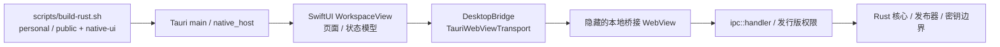
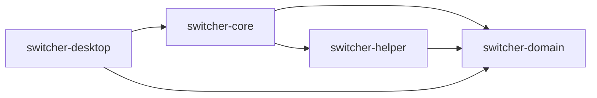
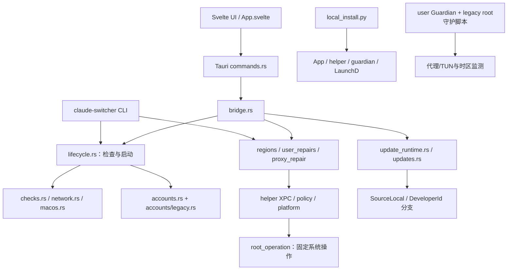

# 当前项目代码图谱

## 2026-10-28：当前原生界面路径

CodeGraph 已同步：303 个文件、7,449 个节点和 29,518 条关系；索引状态 complete，待处理变更为 0。静态图不能代替实际运行验证。

`Bridge/` 负责界面状态和固定命令映射；`Pages/` 负责原生页面，广告预览与总览共用 `AdCard`；`Design/` 负责暖色玻璃材质和共享布局。Personal 注册广告运营命令；Public 禁止这些命令。图片和加密备份的 IPC 参数支持 Base64，也保留原有字节数组兼容。未启用 `native-ui` 的开发构建仍使用原 Svelte 页面。

以下为 2026-10-24 交接快照。它保留历史审核关系，不代表当前产品入口。代码来自当时的 current/，旧版对照来自 original_HEAD/。

## 覆盖与可信边界

独立快照索引：**154 个可解析文件、77 个 Rust 文件、3,834 个符号节点、14,817 条静态关系**。全部索引文件 SHA256 与源码快照一致。原仓库索引混有历史副本，且旧 accounts/ 忽略规则漏掉新的账号模块，所以本次使用独立索引。未修改原仓库忽略规则。

机读图完整保留 contains/calls/imports/references/implements/instantiates/decorates。包含测试和实验，不能直接用节点数证明代码冗余。静态匹配可能存在歧义；动态行为仍需源码与运行证据。Shell、PowerShell、配置和资产在源包中，不虚构其 AST 调用边。

## 四个 Cargo 包

上图必须结合 codegraph/workspace-packages.json 查看真实本地依赖。后面的职责图用于导航，具体符号关系见机读图。

## 产品入口与职责导航

这些图不表示每条高层箭头都是一次直接函数调用。请在 symbols.json 查实际符号、行号和静态边，再回到源码证明可达性。

## 旧项目与新项目的审核入口

| 旧版入口 | 当前审核入口 | 需要证明的关系 |
|---|---|---|
| core/claude-switch.sh | crates/switcher-core/src/bin/claude-switcher.rs、checks.rs、lifecycle.rs | 14项条件、默认流程、退出码是否一致 |
| shell账号命令 | accounts.rs、accounts/legacy.rs、migration.rs、bridge.rs | 当前生产路径、旧状态兼容与重复实现 |
| app/main.swift | apps/desktop/src/App.svelte、src-tauri/src/commands.rs | 开窗检查、选账号启动、成功退出 |
| daemons/*.sh / plist | Guardian bin、guardian.rs、timezone_guard.rs、local_install.py | root脚本与用户态组件分工及是否重复 |
| installer/*.command | packaging/macos/local_install.py、helper | 管理员边界、备份、恢复与日常使用门槛 |
| 旧 update | updates.rs、update_runtime.rs、lifecycle.rs | 本地版例外与Public产品要求是否混淆 |
| 原项目无广告 | ads.rs、ad_runtime*、publisher/*、Operations.svelte | 新增广告是否限定在已提出需求内 |

## 如何读机读图

1. 在 files.csv 找文件与解析状态。
2. 在 nodes.csv 按 file_path 与 name 找符号，使用 start_line/end_line 回查源码。
3. 在 edges.csv 用 source/target 节点ID追踪具体关系。
4. file-relations.csv 仅汇总跨文件静态边，不代表调用次数或实时执行频率。
5. coverage.json 列出未解析文件；这些文件仍在完整源码包中，不能跳过审核。

路径采用审核包内相对路径。current/ 下源文件保持原始字节，TXT 上传版单独增加行号。不要把 TXT 行号前缀当成源码。
